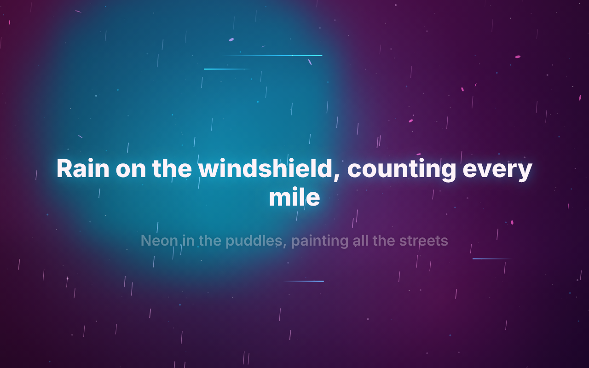

# Lyric Lights

A live visualizer for whatever you're playing on Spotify. Play a song on any device and this page turns it into light:

- **Album art → colors.** The cover is quantized into a palette (median cut, written from scratch) that drives the background, glow and particles.
- **Lyrics → imagery.** Time-synced lyrics come from [LRCLIB](https://lrclib.net). Each line is scanned for themes: rain, fire, night, snow, gold, love, city, nature. Those themes switch on matching effects (rain streaks, rising embers, stars, snow, sparkles, soft glow, neon streaks, petals) at the moment the line is sung.
- **Lyric mood → tone.** Each line gets a sentiment score (AFINN word list). Happy songs are warmer and brighter, sad ones cooler and darker.
- **Lyric speed → motion.** Words per minute, measured from the lyric timestamps, sets how fast everything moves. Fast rap moves; ballads drift.
- **Beat → pulse (optional).** Spotify's audio is DRM-protected, so the page can't read it. With the mic on, it listens to the music in the room and pulses on the kick drum.



**[Watch the demo](https://liamskillern.github.io/lyric-lights/?demo)** (made-up songs, no Spotify account needed).

## How it works

```
Spotify Web API ──(poll every 1.5 s)──► now playing + position
        │                                      │
        ▼                                      ▼
  album art URL                        LRCLIB synced lyrics
        │                                      │
  median-cut palette                 sentiment + themes + words/min
        └──────────────► scene.ts ◄────────────┘
                     (the "director": song data → visual targets)
                               │
                 canvas renderer eases toward the targets every frame
```

There is no backend. The page logs in with **Authorization Code + PKCE**, so it never needs a client secret, and it talks straight to Spotify and LRCLIB.

| File | What it does |
|---|---|
| `src/auth.ts` | PKCE login, CSRF `state` check, token refresh |
| `src/spotify.ts` | Polls "currently playing", estimates the position between polls, backs off on 429 |
| `src/lyrics.ts` | LRCLIB lookup with fuzzy fallback, LRC parser, binary search for the current line |
| `src/palette.ts` | Median-cut quantizer and palette roles (vibrant, secondary, dark, light) |
| `src/mood.ts` | Line sentiment, theme keywords, words per minute |
| `src/scene.ts` | Maps everything to colors, speed, brightness and effect levels |
| `src/audio.ts` | Optional mic beat detector |
| `src/render/` | Background, particle effects, lyric typography |

## Security and privacy

- **PKCE + `state`:** no client secret ships in the page, and a login started by another site is rejected.
- **Content-Security-Policy** (production build): scripts only from this site, network calls only to Spotify and LRCLIB, images only from Spotify's CDNs.
- **No HTML injection:** song titles and lyrics are drawn on the canvas or set with `textContent`, never `innerHTML`.
- **Least privilege:** the only scopes are `user-read-currently-playing` and `user-read-playback-state`.
- Tokens are kept in this browser's `localStorage`, and "Log out" clears them. The mic audio is analyzed live and never recorded or sent anywhere.

## Run it yourself

1. Create an app at [developer.spotify.com/dashboard](https://developer.spotify.com/dashboard) and tick **Web API**.
2. Add the Redirect URIs `http://127.0.0.1:5173/` (local) and `https://<you>.github.io/lyric-lights/` (deployed). Spotify doesn't accept `localhost`; use `127.0.0.1`.
3. Under **User Management**, add the Spotify accounts that will use it. New apps run in development mode, which only works for accounts listed there.
4. Run it:

```bash
npm install
npm run dev
```

Open http://127.0.0.1:5173/ and paste your Client ID when asked, or put it in `.env` as `VITE_SPOTIFY_CLIENT_ID` (see `.env.example`). The Client ID isn't a secret.

**Keys:** `L` lyrics on/off · `M` beat mic · `F` full screen · `[` / `]` nudge lyric timing (useful with Bluetooth delay) · `0` reset timing.

## Tests

```bash
npm test          # unit tests (Vitest): LRC parsing, PKCE, palette, mood, scene, beat detector
npm run e2e       # browser checks (Playwright) against the production build, with Spotify mocked
```

`npm run e2e` needs Playwright: `npm i -D playwright && npx playwright install chromium`.

## Deploy

`.github/workflows/deploy.yml` tests, builds and publishes to GitHub Pages on every push to `main`. Turn on Pages under **Settings → Pages → Source: GitHub Actions**. Optionally, set a repository variable `SPOTIFY_CLIENT_ID` so visitors skip the setup step.

## Limits

- Spotify stopped giving new apps tempo, energy and beat data (Nov 2024), so mood comes from the lyrics and the beat comes from the mic.
- Not every song is on LRCLIB. Without synced lyrics, the visuals use the colors plus whatever mood and themes the plain lyrics or the title give.

Not affiliated with or endorsed by Spotify. Lyrics come from LRCLIB.
