# Lyric Lights: Project Report

*Features, options, and what to know about the app. Last updated 2026-11-23.*

**Live app:** https://liamskillern.github.io/lyric-lights/
**Demo (no login):** https://liamskillern.github.io/lyric-lights/?demo
**Code:** https://github.com/liamskillern/lyric-lights

---

## 1. Summary

Lyric Lights is a web page that turns whatever you're playing on Spotify into a live, full-screen visual. It reads the song that's playing on any of your devices and builds the picture from the song itself:

- **Colors** from the album art
- **Effects** from the words in the lyrics (rain, fire, stars, snow…)
- **Mood** from how happy or sad the lyrics are
- **Speed** from the song's tempo (BPM)
- **Beat**, heard through the computer's sound or a mic, or tapped in by hand

It runs entirely in the browser. There is no server, no account system and no cost.

**Status**

| Area | State |
|---|---|
| Features | All built and live (list below) |
| Automated tests | 168 unit tests + 88 browser checks, all passing; run on every push |
| Android | Installable from Chrome; Play Store app built and signed, waiting on the Play Console steps ([ANDROID.md](ANDROID.md)) |
| Security review | Done; 10 findings fixed (section 7) |
| Real Spotify account | **Not tested yet.** Every check so far used simulated Spotify data, because the build machine can't reach Spotify. The first real-world test is still to do (section 2). |
| Real system-audio beat sync | **Not tested yet** with real music; only with a simulated mic/screen share |

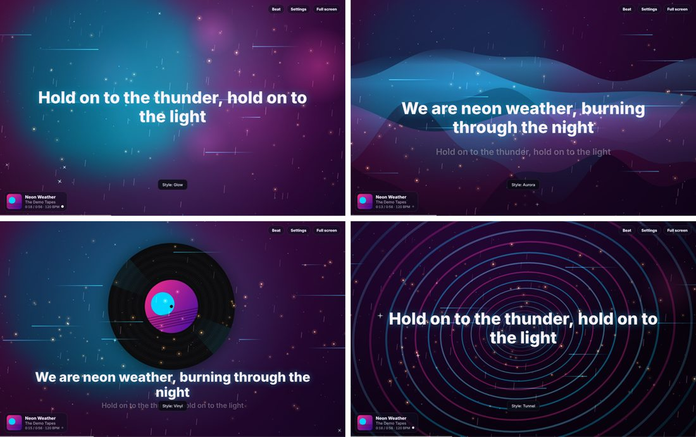
*The four visual styles: Glow, Aurora, Vinyl, Tunnel.*

---

## 2. Getting started

### Just watch the demo
Open the demo link above. It plays two made-up songs with original lyrics and its own cover art, so anyone can see the app without Spotify.

### Connect your Spotify (one-time, ~5 minutes)
1. Go to **developer.spotify.com/dashboard** → **Create app**. Don't put "Spotify" in the name; their rules forbid it.
2. Add these **Redirect URIs** exactly:
   - `https://liamskillern.github.io/lyric-lights/`
   - `http://127.0.0.1:5173/` (only needed for running it on your own computer)
3. Tick **Web API** and save.
4. Under **User Management**, add the Spotify account(s) that will use it. Spotify keeps new apps in *development mode*, which only works for accounts listed there: **up to 5**, and **the app owner needs Spotify Premium** (Spotify's rules since February 2026).
5. Copy the app's **Client ID** (it's not a secret). Open the live app, paste it, and click **Connect Spotify**.
6. Play a song on any device. Your phone works, and the visual shows on the computer or TV running the page.

Optional: to skip step 5 for everyone, set a repository variable `SPOTIFY_CLIENT_ID` under GitHub → Settings → Secrets and variables → Actions → Variables. The next deploy builds it in.

### Run it on your own computer
```bash
npm install
npm run dev
```
Then open http://127.0.0.1:5173/. Use `127.0.0.1`, not `localhost`: Spotify rejects `localhost`.

---

## 3. Features

### Visuals
| Feature | What it does |
|---|---|
| **Album-art colors** | The cover is turned into a palette (a hand-written median-cut quantizer) that colors the background, glow and particles. Colors cross-fade between songs. |
| **Four styles** (`V`) | **Glow:** blurred cover art and drifting color blobs. **Aurora:** curtains of light. **Vinyl:** the cover as a spinning record, with lyrics below. **Tunnel:** rings rushing toward you. |
| **Lyric effects** | Words in each line switch on effects as it's sung: rain/ocean/tears → rain · fire/burn → embers · night/stars/moon → stars · snow/cold → snow · gold/money/diamond → sparkles · love/heart → soft glow · city/street/drive → neon streaks · nature/flowers/sun → petals. The song's most common themes stay on quietly in the background. |
| **Mood** | Each line gets a sentiment score (AFINN word list). Happy songs look warmer and brighter, sad ones cooler and darker. |
| **Chorus moments** | Repeated lyric lines are detected as the chorus. In the chorus everything is brighter, 20% faster, with more effects and bigger lyrics, and a sparkle burst when it starts. |
| **Idle screensaver** | When nothing is playing: calm aurora light with a large clock that slowly drifts (no screen burn-in). |

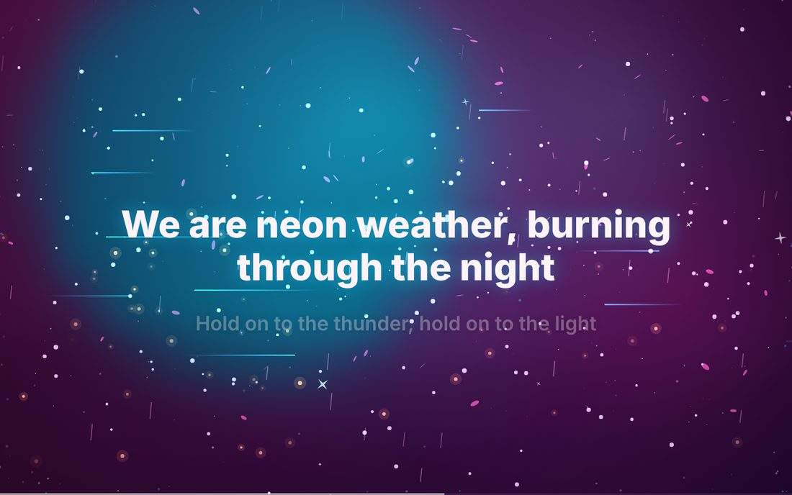
*A chorus moment: more effects, brighter, bigger text.*

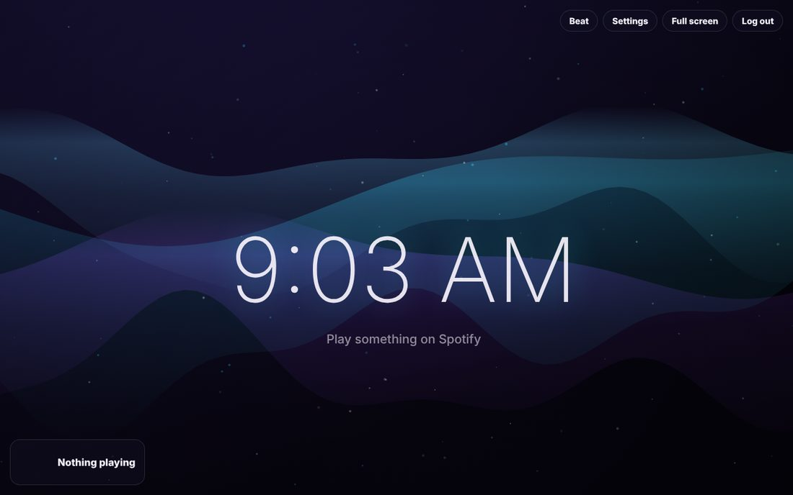
*The idle screen when nothing is playing.*

### Music sync
| Feature | What it does |
|---|---|
| **Tempo → speed** | All motion scales with BPM (about 0.8× at 70 BPM, 1.55× at 170 BPM). Tempo comes from the beat sync, from your taps, or is guessed from lyric timing. |
| **Beat pulse** | A beat clock keeps a steady pulse at the tempo, so the whole background breathes on every beat, harder on each bar's first beat. A dot next to the BPM blinks in time. |
| **Beat sync** (`B`) | Listens to the music. On a computer (Chrome/Edge) it uses the **computer's own sound** through the screen-share prompt; the picture is thrown away and only the sound is used. On phones it uses the **mic**. It provides real beats, live BPM, and bass/mid/treble levels that drive the glow, brightness and sparkle. |
| **Tap the beat** (`Space`) | Tap Space along with the song 4+ times to set the beat by hand. Accurate even without a mic. |
| **Kick motion** | The background rides the drums. Kicks punch in and push it in a turning direction (down, left, up, right); snares shake it sideways. It springs back with a small bounce, and the lyrics stay still. |

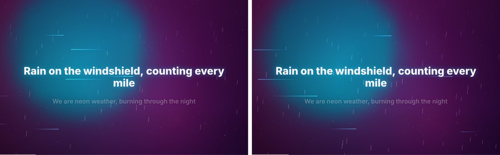
*On the beat (left) the background is zoomed in and brighter; between beats (right) it settles. The lyrics don't move.*

**Where the BPM comes from** (shown in the now-playing card):
| Label | Source | Accuracy |
|---|---|---|
| `128 BPM` | Heard by beat sync, or exact (demo songs) | Best: follows the music live |
| `100 BPM · tapped` | You tapped Space | As good as your tapping |
| `~120 BPM` | Guessed from when lyric lines start | Rough; only used when the guess is confident |

### Lyrics
| Feature | What it does |
|---|---|
| **Synced lyrics** | Time-synced lyrics from LRCLIB (free, community-run). If the timing is off (Bluetooth delay, for example), press `[` / `]` to shift by 0.1 s. |
| **Fonts** (`T`) | Modern, Poster, Elegant, Marker, Retro, Mono, or **Auto**, which picks per song: Poster for fast or upbeat, Elegant for slow or sad, Marker for rap-speed lyrics. |
| **Animations** (`A`) | How each new line arrives: Rise, Fade, Pop, Slide, Typewriter, Karaoke words. |
| **Karaoke mode** (`K`) | Three lines at once, each word filling with color as it's sung, countdown dots (● ● ●) before you need to come in, and a darker background so the words stay readable. Uses real word timings when the lyrics include them. |

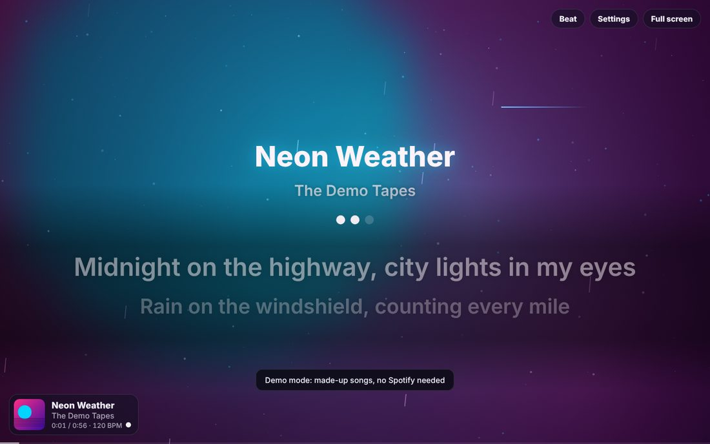
*Karaoke mode before the first line: the countdown dots.*

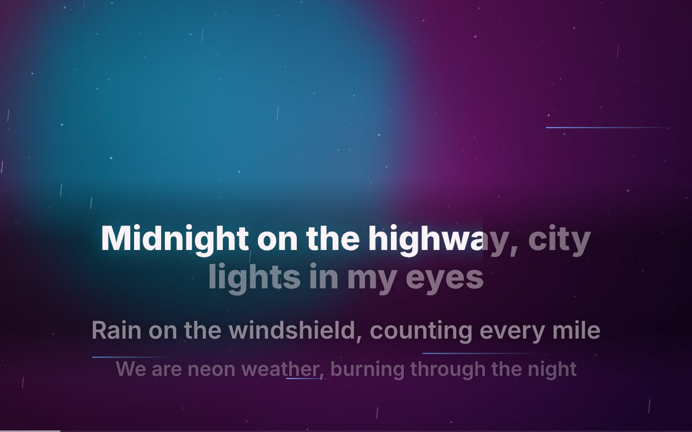
*Karaoke mode: the current line fills word by word; the next two lines wait below.*

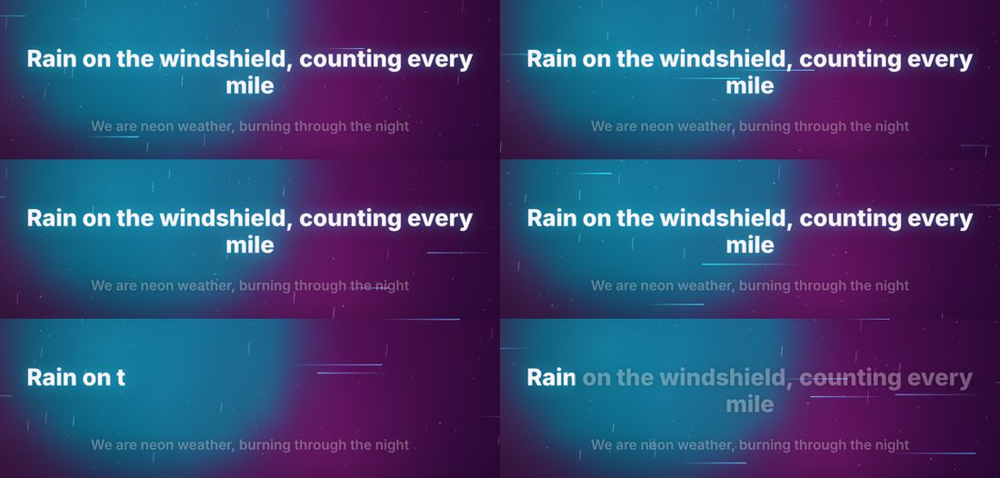
*Lyric animations (left to right, top to bottom): Rise, Fade, Pop, Slide, Typewriter mid-reveal, Karaoke words mid-fill.*

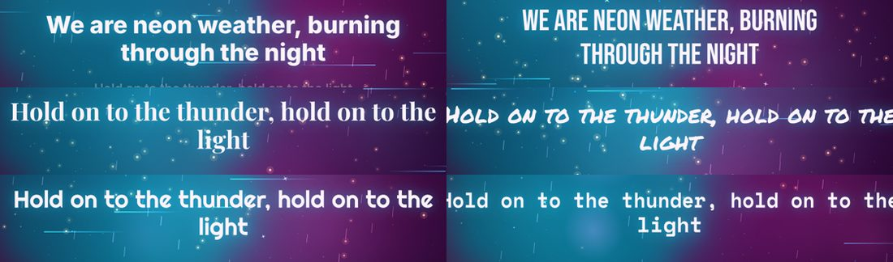
*The six fonts: Modern, Poster, Elegant, Marker, Retro, Mono.*

### Song info
| Feature | What it does |
|---|---|
| **Now playing** | Cover, title, artist, time and BPM in the corner. The controls and cursor hide after a few seconds without mouse movement. |
| **Progress line** | A thin line along the bottom edge. |
| **Up next** | In the last 15 seconds of a song, a card shows the next song in your Spotify queue. |

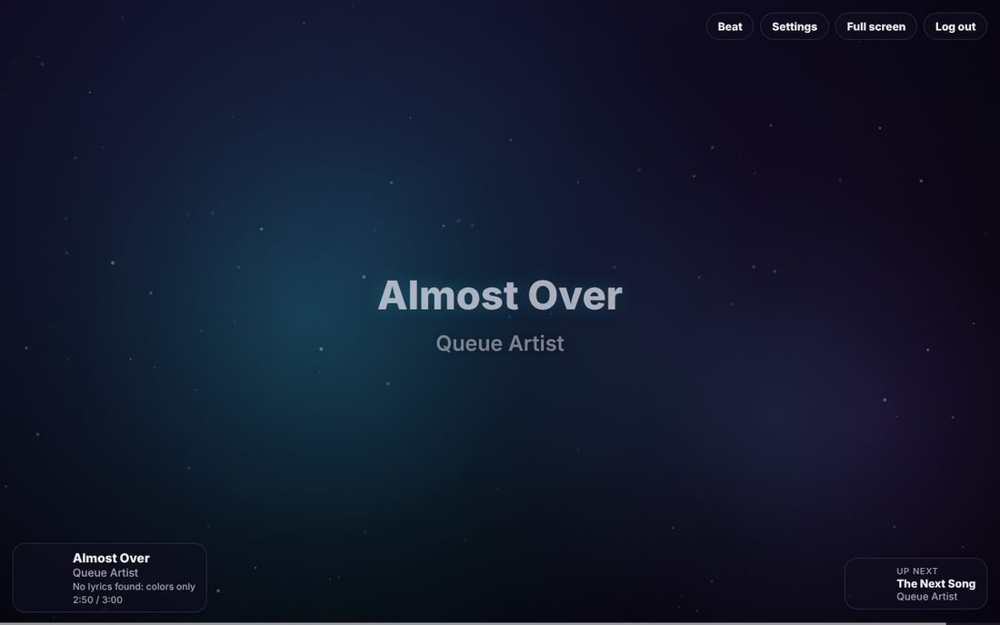

---

## 4. Controls

| Key | Action |
|---|---|
| `Space` | Tap the beat (4+ taps) |
| `B` | Beat sync on/off (uses your chosen source) |
| `M` | Beat sync from the microphone |
| `V` | Next visual style |
| `T` | Next lyric font |
| `A` | Next lyric animation |
| `K` | Karaoke mode on/off |
| `L` | Lyrics on/off |
| `[` / `]` | Lyrics 0.1 s later / earlier |
| `0` | Reset lyric timing |
| `S` | Settings |
| `F` | Full screen |

Buttons at the top right: **Beat**, **Settings**, **Full screen**, **Log out**. Shortcuts are paused while the settings panel is open.

---

## 5. Settings

Open with `S` or the **Settings** button. Settings are remembered in this browser and checked when loaded, so a broken or edited value falls back to the default.

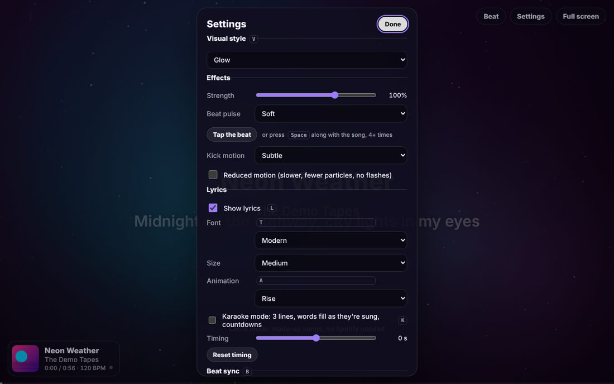

| Setting | Options | Default | Notes |
|---|---|---|---|
| Visual style | Glow, Aurora, Vinyl, Tunnel | Glow | Also `V` |
| Effect strength | 0–150% | 100% | Halved automatically in karaoke mode |
| Beat pulse | Off, Soft, Punchy | Soft | How much the background breathes on each beat |
| Tap the beat | button | — | Same as `Space` |
| Kick motion | Off, Subtle, Strong | Subtle | Background moves with kicks and snares |
| Reduced motion | on/off | Follows your device's setting | Slower, fewer particles, no flashes, no zoom; moving lyric animations become fades |
| Show lyrics | on/off | On | Also `L` |
| Font | Auto, Modern, Poster, Elegant, Marker, Retro, Mono | Modern | Also `T` |
| Lyric size | Small, Medium, Large | Medium | |
| Animation | Rise, Fade, Pop, Slide, Typewriter, Karaoke words | Rise | Also `A` |
| Karaoke mode | on/off | Off | Also `K` |
| Lyric timing | −3 s to +3 s | 0 | Also `[` `]` `0` |
| Beat sync source | Off, Computer sound, Microphone | Computer sound on desktop, Mic on phones | "Computer sound" only appears where the browser supports it |
| Beat sensitivity | 0–100% | 50% | Higher catches more beats |
| Show "Up next" | on/off | On | |

---

## 6. Where the data comes from

| Data | Source | Notes |
|---|---|---|
| What's playing, progress, cover art | Spotify Web API `GET /me/player/currently-playing` | Polled every ~1.5 s while playing, slower when paused or the tab is hidden, faster just before a song ends |
| Next song | Spotify `GET /me/player/queue` | Asked once per song and once near its end |
| Lyrics | LRCLIB (`lrclib.net`) | Free, no key; exact match first, then a fuzzy search |
| Tempo | Beat sync, your taps, or a guess from lyric timing | Spotify no longer gives tempo to new apps |
| Mood | Lyric words, scored with the AFINN list | Done in the browser |

Spotify permissions requested (both **read-only**): `user-read-currently-playing`, `user-read-playback-state`. The app can't control playback, change playlists, or see your email or payment details.

---

## 7. Privacy and security

**What's stored, and where**
| Item | Where | How long |
|---|---|---|
| Spotify access token | Page memory only | Until reload |
| Spotify refresh token | `sessionStorage` (this tab only) | Until the tab closes or you log out |
| Spotify refresh token, `?wallpaper` mode only | `localStorage` (`sv.wallpaper.refresh`), inside the wallpaper app's own browser profile | Until you log out or revoke the app ([docs/WINDOWS_WALLPAPER.md](WINDOWS_WALLPAPER.md#security)) |
| Client ID, settings | `localStorage` | Until cleared; neither is secret |
| Audio from mic or computer sound | Nowhere: analyzed live, never recorded or sent | Until you turn beat sync off, log out, or the login ends |

**Protections in place**
- **Login:** OAuth Authorization Code with **PKCE** (no client secret in the page) and a `state` check against login CSRF.
- **Content-Security-Policy:** scripts and styles only from the site itself, network only to Spotify and LRCLIB, images only from Spotify's CDNs, no frames. The only worker is the site's own offline page (`sw.js`), which never touches Spotify or LRCLIB requests. Fonts are self-hosted, so no font service sees visitors.
- **Clickjacking guard:** the page refuses to run inside another site's frame.
- **No HTML injection:** song titles, lyrics and error codes are never inserted as HTML. Unknown `?error=` values in a link get a fixed message.
- **Untrusted data is checked:** LRCLIB and Spotify responses are type-checked and size-capped (1 MB response, 2,000 lines, 300 characters per line). Caches are bounded.
- **The mic really turns off:** turning beat sync off, logging out, or the Spotify login ending always stops the mic or computer-sound capture, even after a double click or an "Off" pressed while the browser is still asking. (Fixed in the Nov 23 audit; browser checks confirm no audio stream is left running.)
- **Supply chain:** GitHub Actions are pinned to exact commits, the token isn't left on disk during builds, and Dependabot proposes weekly updates. `npm audit`: 0 known vulnerabilities.

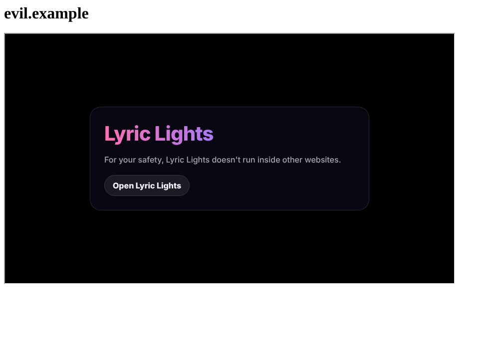
*Loaded inside another site's frame, the app refuses to start.*

**What's left over (known and accepted)**
- All GitHub Pages sites under `liamskillern.github.io` share one storage area. The fixes above keep long-lived tokens out of shared storage, but full isolation would need separate hosting (for example Cloudflare Pages, free). Today Lyric Lights is the only site there, so **don't turn on GitHub Pages for another repo** (such as `homelab`) without moving this app first.
- **Logging out doesn't revoke access at Spotify** (Spotify offers no way to). To cut the app off completely, remove it at **spotify.com/account/apps**. The logout screen links there.

---

## 8. Accessibility and safety

- **Flashes are limited to 3 per second** (WCAG 2.3.1), even on fast songs.
- **Beat brightness changes stay under 10%**, below what WCAG counts as a flash.
- **Reduced motion** is on automatically if your device asks for it: slower, fewer particles, no flashes, no zoom or shake, and fades instead of moving lyric animations.
- **Kick motion is capped** at about 4% of the screen, and the lyrics never move with it.
- The settings dialog works fully by keyboard: `Esc` closes it and focus returns to the button.
- The idle clock drifts slowly to avoid burn-in on TVs and OLED phones.

---

## 9. Device and browser support

| Device / browser | Visuals & lyrics | Beat sync | Notes |
|---|---|---|---|
| Windows/Mac, **Chrome or Edge** | ✅ | ✅ Computer sound or mic | Best experience |
| Firefox, Safari (desktop) | ✅ | Mic only | No computer-sound sharing |
| Android / iPhone | ✅ | Mic only | Keep-screen-on is requested automatically. **Android:** install from Chrome (⋮ → Install app) or the Play Store app ([ANDROID.md](ANDROID.md)) |
| TV browser / cast | ✅ | Usually none | Use `Space` to tap the beat, or rely on the guess |

**Using computer sound (Chrome/Edge):** press `B`, choose **Entire screen**, and tick **"Also share system audio"**. That captures the Spotify desktop app too. Sharing just a browser tab works for music playing in that tab. Spotify protects its web-player audio, so if tab sharing gives no beat, use Entire screen.

---

## 10. Limits and known issues

- **Spotify development mode:** only accounts added under User Management can log in (up to 5 per app, and the owner needs Premium, since February 2026). Everyone else gets "access refused" and can still use the demo, or use their own Client ID. Extended quota is only for businesses.
- **No tempo or beat data from Spotify:** they removed it for new apps in Nov 2024. That's why tempo is heard, tapped or guessed.
- **Not every song is on LRCLIB.** Without synced lyrics the app shows colors and uses whatever mood and themes the title or plain lyrics give.
- **The tempo guess from lyrics is rough** (marked with `~`). Tap `Space` or turn on beat sync for accuracy.
- **Lyric timing can be slightly off** for some songs or with Bluetooth speakers. Use `[` / `]`.
- **Closing the tab logs you out** (on purpose, for security); reconnecting is one click.
- **Not yet verified with a real Spotify account or real system audio** (see Status).

---

## 11. Costs

Everything is free:
| Piece | Cost | If lots of people visit |
|---|---|---|
| GitHub Pages hosting | Free | Soft limit ~100 GB/month (~500,000 visits); GitHub throttles, doesn't bill |
| GitHub Actions (tests/deploy) | Free for public repos | Runs only on pushes, not visits |
| Spotify API | Free | Rate-limited per app; only allow-listed users can log in |
| LRCLIB | Free | Each visitor's browser asks directly |

Nothing has a card attached. The only idea that *would* cost money is a Claude-powered "scene director" (section 14). It would need a spending cap before being built.

---

## 12. Troubleshooting

| Problem | Fix |
|---|---|
| "Spotify refused access (403)" | Add your account under **User Management** in the Spotify app dashboard |
| Login fails mentioning the Redirect URI | The URI must match exactly, including the trailing `/` |
| "No lyrics found: colors only" | LRCLIB doesn't have that song; the visuals still work |
| Lyrics early or late | `[` / `]` (saved), or Settings → Lyric timing |
| "No sound was shared" | Share again and tick **Also share system audio** (Chrome/Edge on a computer) |
| BPM looks wrong | Tap `Space` along with the song, or turn on beat sync (`B`) |
| Too much motion | Settings: Beat pulse / Kick motion → Off or Soft, or turn on Reduced motion |
| Clock screen instead of visuals | Nothing is playing, or it's been paused 30+ seconds; press play on Spotify |
| Page shows 404 right after a deploy | Wait a minute and refresh (GitHub Pages cache) |

---

## 13. How it's built

**Stack:** TypeScript + Vite, a single `<canvas>`, no UI framework, no backend. Hosted on GitHub Pages.

```
Spotify Web API ──(poll ~1.5 s)──► now playing + position ──► song clock
        │                                   │
   cover art URL                    LRCLIB synced lyrics
        │                                   │
 median-cut palette           mood · themes · chorus · tempo guess
        └──────────► scene.ts (song data → visual targets) ◄── beat sync / taps / beat clock
                                    │
         renderer: style → effects → camera (beat breath, kicks) → lyrics
```

| File | Role |
|---|---|
| `src/auth.ts`, `src/storage.ts` | PKCE login, token handling, safe storage |
| `src/spotify.ts` | Polling, playback clock, queue |
| `src/lyrics.ts` | LRCLIB fetch, LRC parser (incl. word timings), limits |
| `src/palette.ts`, `src/color.ts` | Album-art palette |
| `src/mood.ts` | Sentiment, themes, chorus detection |
| `src/tempo.ts`, `src/beatClock.ts` | Tempo detection and guessing, beat clock, tap tempo |
| `src/audio.ts` | Computer-sound / mic input, beat and snare detection, bands |
| `src/scene.ts` | Maps everything to colors, speed, brightness, effects |
| `src/settings.ts`, `src/fonts.ts` | Settings with validation, fonts |
| `src/render/` | Styles, effects, camera, lyrics, animations, karaoke, idle screen |
| `src/main.ts` | Wires it all together; UI and keys |

---

## 14. Testing, deployment, maintenance

- **Unit tests:** 168 (Vitest), covering the LRC parser, PKCE, palette, mood, chorus, tempo, beat clock, camera, settings validation, security cases, the Android app settings and more. `npm test`
- **Browser checks:** 88 (Playwright), against the production build with its security policy, with Spotify and LRCLIB simulated: login and logout, storage, the frame guard, the error link, every style, font and animation, karaoke, idle screen, up next, beat sync with a fake mic, the mic really stopping (double click, Off mid-prompt, session ending), beat pulse timing, tap tempo, the app manifest and icons, the offline page and the privacy policy. `npm run e2e`
- **Deploy:** every push to `main` runs the tests, builds and publishes to GitHub Pages automatically.
- **Updates:** Dependabot opens weekly pull requests. One is open now (TypeScript 7, Vitest 5, major versions); it needs checking before merging.

---

## 15. Next steps

1. **First real test:** create the Spotify app (section 2), play a fast and a slow song, try beat sync on the PC, and tune what feels off.
2. **Google Play:** follow [ANDROID.md](ANDROID.md) (internal testing now; 12 testers for 14 days before going public).
3. Review the open Dependabot pull request.
4. Record a short GIF for the README.
5. Portfolio write-up for the career folder.

**Ideas for later:** smart lights (Hue/WLED) following the same scene · a WebGL renderer for richer effects · a Claude "scene director" (needs a spending cap) · moving to Cloudflare Pages for full storage isolation and real security headers.
